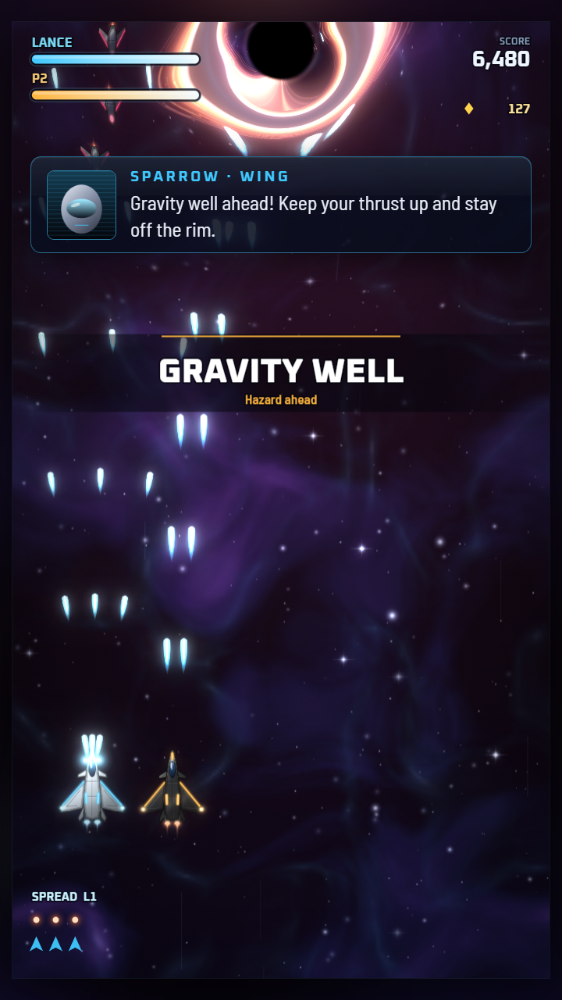
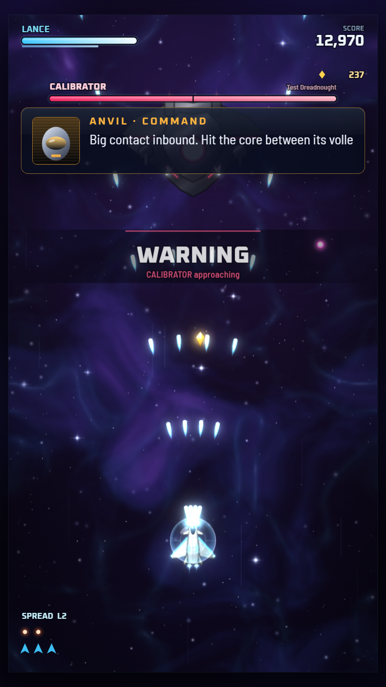
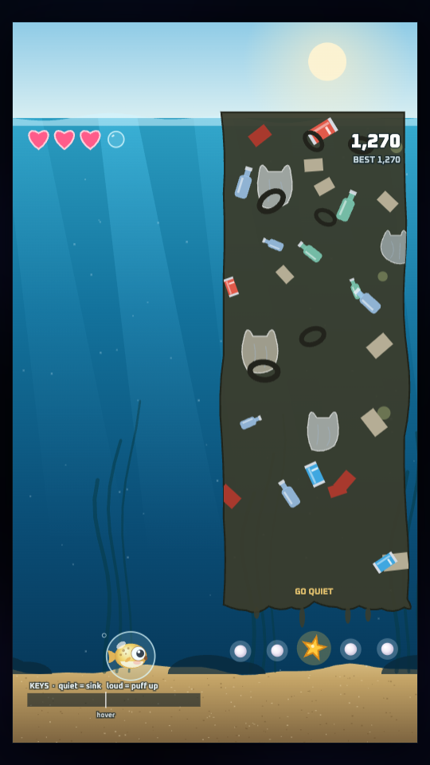
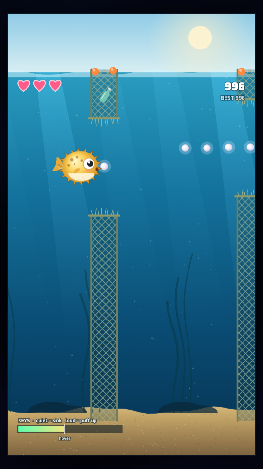

# Earth Vanguard

A vertical-scrolling space shooter that runs in the browser, built for **Technica 2026**.

The Nyx Armada has come out of the Tartarus Rift towing captive black holes and is dropping them on human
worlds. You are the test pilot of the XF-9 *Starlance*, flying from the carrier UNS *Halcyon*, the last
warship at the Vesta Line. Across five missions you fight through swarms of enemy jets, pull survivors out
of drifting escape pods, and take on screen-filling bosses that break apart in stages. A friend can jump in
at any time and fly the gold twin jet, the XF-9B *Sunlance*.

Riding along with you is **Puff**, your pufferfish best friend. Clear the first mission to unlock
**Puff's Ocean**, a voice-controlled minigame where Puff swims home through Earth's polluted ocean.

<p align="center">
  
  
  
  
</p>

## Play it

No install, no server, no build step needed:

1. Download or clone this repo.
2. Open **`dist/earthvanguard.html`** in a modern browser (Chrome, Edge, Firefox or Safari). Double-clicking
   it works.

The whole game, including art, sound effects and fonts, lives in that one HTML file. All graphics are drawn in
code and all audio is synthesized at runtime, so there are no image or sound assets.

For Puff's voice controls, Chrome or Edge works best. If the mic is blocked when opening the file directly,
serve the folder instead (`python3 -m http.server 8000`, then open <http://localhost:8000/dist/earthvanguard.html>).

## Controls

Firing is automatic. Hold Fire to keep shooting when auto-fire is off.

| Action | Solo (keyboard) | Co-op Player 1 | Co-op Player 2 | Gamepad |
|---|---|---|---|---|
| Move | WASD or arrow keys | WASD | Arrow keys | Left stick / D-pad |
| Fire | Space, Z or J | Space | `/` or Numpad Enter | (auto) |
| Bomb | X, Q or K | Q | Enter or Numpad 0 | A |
| Skill | C, E or L | E | Right Shift or Numpad 1 | X or B |
| Focus (slow, precise movement) | Shift | Left Shift | Right Ctrl or Numpad 2 | LB / RB |
| Pause | Esc or P | Esc or P | Esc or P | Start |

On touch screens, drag anywhere to move. The jet follows your finger's motion, so your thumb never covers it.

**Landscape or portrait.** On a wide screen (a laptop, or a phone turned sideways) the game plays as a side-scroller:
your jet flies right and enemies come from the right, and the arrow keys and stick follow the screen. On a tall
screen it plays as a vertical shooter. It switches automatically when the window or phone turns. **Text size**
(Normal, Large, Extra large) is on the title screen.

### Echo

| Action | Keys | Touch / gamepad |
|---|---|---|
| Move | WASD or arrow keys | Drag / left stick |
| Echo (light up the walls) | Space, Z or J | Tap / A, X, B or RT |
| Sneak (half speed) | Shift | LB / RB |
| Pause | Esc or P | Start |

### Puff's Ocean

| Action | Voice | Keys / touch / gamepad |
|---|---|---|
| Puff up and float | Get loud: "ahh", a hum, a whistle | Hold Space, Up or W, hold the screen, or hold the right trigger |
| Shrink and sink | Go quiet | Let go (Down or S sinks faster) |
| Pause | Esc or P | Esc or P |

Before a voice run, Puff tunes itself to *your* voice: 2 seconds of quiet, then your loudest comfortable
sound. A soft hum plays as well as a scream. In voice mode the game is hands-free: make a sound to start, and
hum for a second on the game-over screen to swim again. The mic only measures loudness inside the page;
nothing is recorded or sent.

## What's in the build

**Playable now**

- **Flight test mission:** the current Mission 1 ("First Light (stub)") is a test range that runs through
  every system: enemy waves and formations, a black hole, escape-pod rescues, a radio choice, a checkpoint
  and a boss fight.
- **Weapons that change what you see:** twin pulse lasers, a widening spread fan, a piercing lance beam
  (each with five levels), plus homing missiles and screen-clearing bombs.
- **Space hazards:** black holes that bend your lasers and the screen around them, asteroid storms, ion
  storms, solar flares, mine fields and wormholes.
- **Rescue:** pull survivors out of escape pods drifting through the crossfire.
- **Local co-op** for two players on one keyboard, two gamepads, or a mix.
- **Echo:** a stealth minigame about the protagonist's escape. She grew up as a test subject inside a sealed
  facility, and the experiments left her able to see with sound. With the power out, every echo she sends lights
  up the walls for a moment, but security drones hear it too. Three floors to the surface, each behind a keycard
  door. Open from the title screen for now (no story trigger yet).
- **Puff's Ocean** (unlocked by clearing Mission 1): dodge ghost nets, oil spills, plastic bags, six-pack
  rings and leaking drums; squeeze under floating garbage patches; collect pearls, starfish (extra hearts)
  and bubble shields. Every game over shows a real ocean-pollution fact.

**Designed, not wired into missions yet:** the full five-mission campaign, four side stories, the hangar
and skill tree, music and the full radio cast are written up in [`docs/GDD.md`](docs/GDD.md). Three of the
bosses (Suneater, Mantis and Crucible) are built and can be fought in their test sandboxes, for example
`?sandbox=boss:boss_suneater`.

## How it's built

Plain JavaScript, HTML canvas and the Web Audio API, with no frameworks or libraries. Black-hole lensing
uses WebGL when it's available and falls back to a 2D canvas when it isn't.

```
src/      game source: numbered JS/CSS modules plus shell.html (the page skeleton)
tools/    build script and headless test tools
dist/     built game (earthvanguard.html)
docs/     game design doc, architecture contract, API notes, screenshots
shots/    screenshots captured by the automated tests
```

To rebuild after editing anything in `src/`:

```sh
python3 tools/build.py
```

This inlines every `src/*.css` and `src/*.js` file, in name order, into `dist/earthvanguard.html` (and into
`dist/publish/index.html` for web hosting).

Handy URL parameters for testing (add them to the end of the file URL):

- `?mission=m1`: jump straight into a mission
- `?sandbox=<id>`: open a test sandbox (for example `boss:boss_suneater`, `hazard:black_hole`, `weapons`)
- `?save=mid&screen=puff`: open Puff's Ocean with a save that has Mission 1 cleared
- `?save=mid&screen=puff&puff=bot`: watch a bot play Puff's Ocean
- `?screen=echo`: open Echo (`&echo=play&sector=1` starts on a floor, `&echo=reveal` keeps every wall lit)
- `&coop=1`: start in two-player mode
- `&boss=1`: skip ahead to the boss
- `&god=1`: invincibility
- `&autopilot=1`: let the game fly itself
- `&debug=1`: performance overlay

For the full design and engineering details, see [`docs/GDD.md`](docs/GDD.md) and
[`docs/ARCHITECTURE.md`](docs/ARCHITECTURE.md).

## Team

Built at Technica 2026 by:

- Yizhan Ao
- Ruijie Chen
- Jazmine Yambo
- Megan Tiller

A project website with the story, campaign, cast and team lives in [`website/index.html`](website/index.html).
